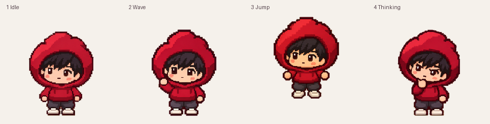
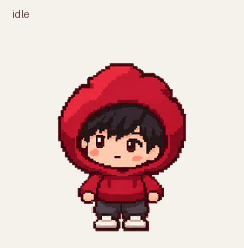

# Fantasy Xiaojie Pixel · 范特西小杰

A cute red-hood pixel companion inspired by Jay Chou's *Fantasy* era: an oversized hood, black fringe, tiny blush cheeks and short little limbs.

[中文说明](README.md) · [Add the companion](https://chatgpt.com/s/sharepet_6af9c4f76ec481919fca50a0cffb36e1) · [Latest release](https://github.com/tblshigg/fantasy-xiaojie-pixel/releases/latest)

  

[MP4 preview](previews/all-states.mp4) · [Sixteen-direction look loop](previews/look-loop.gif)

## Features

- Nine states: idle, running right, running left, waving, jumping, disappointed, waiting for input, focused work and reviewing.
- Sixteen look directions, with an anchored torso and feet.
- Transparent v2 sprite sheet: 1536 × 2288 px, 8 × 11 cells, 192 × 208 px per cell, 73 populated frames.
- A v1 compatibility sheet: 1536 × 1872 px, nine standard animation rows, 57 populated frames.
- Source art, prompts, previews and Python asset tools for customization.

This is an appearance and animation asset project. The host application supplies chat, voice and task capabilities. The GIF preview is enlarged; display size depends on the host's pet settings.

## Install and download

1. Open the [public companion page](https://chatgpt.com/s/sharepet_6af9c4f76ec481919fca50a0cffb36e1), sign in and follow its add/install instructions.
2. In a supported desktop application, open **Settings → Pets** and select **范特西小杰**.
3. Use `/pet` or **Show pet** in the command menu to show the floating companion.

Pet availability and entry points depend on the application version, account and workspace. See the [official Pets guide](https://learn.chatgpt.com/docs/pets).

Download the complete `fantasy-xiaojie-pixel-v1.0.0.zip`, either PNG sheet, or preview files from [Releases](https://github.com/tblshigg/fantasy-xiaojie-pixel/releases/latest). You can also use **Code → Download ZIP** or:

~~~bash
git clone https://github.com/tblshigg/fantasy-xiaojie-pixel.git
cd fantasy-xiaojie-pixel
~~~

The v2 sheet includes the look directions. Use v1 when an upload entry accepts only the 1536 × 1872 format. The downloaded `install.html` provides a desktop installation link where that feature is supported. See the [installation guide in Chinese](docs/INSTALL.md) for detailed steps and troubleshooting.

## Work with the assets

Python 3.10+ is required only for asset processing:

~~~bash
python -m pip install -r requirements.txt
python tools/pet_assets.py validate
python tools/pet_assets.py extract --output output/frames
python tools/pet_assets.py previews --output output/previews
python tools/pet_assets.py package --output dist/fantasy-xiaojie-pixel-v1.0.0.zip
~~~

See [development notes](docs/DEVELOPMENT.md) for the frame layout and editing workflow. Format validation does not replace visual review of motion and direction.

## Credits and license

Created by **tblshigg** with AI-assisted artwork generation and subsequent asset preparation and review. The visual inspiration is documented on [JVR Music's official *Fantasy* album page](https://www.jvrmusic.com/artist/gallery/detail/1152155344949088256?lang=zh_CN&type=album).

Original project code, documentation and artwork are released under the [MIT License](LICENSE). This is an unofficial fan creation, with no affiliation or endorsement by Jay Chou, JVR Music or OpenAI. See [NOTICE.md](NOTICE.md) for scope.

Report display or animation issues in [Issues](https://github.com/tblshigg/fantasy-xiaojie-pixel/issues).

