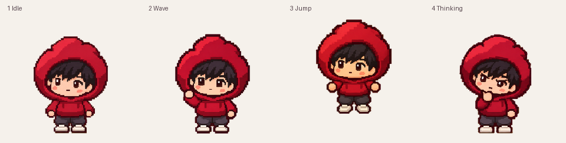
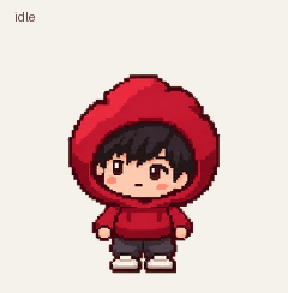

# 范特西小杰 · Fantasy Xiaojie Pixel

一个以周杰伦《范特西》红帽衫造型为灵感的可爱像素伙伴。圆圆的大帽子、黑刘海、小腮红和短手短脚，陪你写代码、学习和完成日常任务。

[English](README.en.md) · [添加伙伴](https://chatgpt.com/s/sharepet_6af9c4f76ec481919fca50a0cffb36e1) · [下载最新版本](https://github.com/tblshigg/fantasy-xiaojie-pixel/releases/latest) · [完整使用教程](docs/INSTALL.md)

## 看看它会做什么

  

[查看 MP4 视频](previews/all-states.mp4) · [看向四周的循环](previews/look-loop.gif) · [静止呼吸与眨眼](previews/idle.gif)

- **九组动作**：待机、向右跑、向左跑、挥手、跳跃、失落、等待回应、专注思考、检查结果。
- **十六个视线方向**：抬头、低头、左右看及中间方向，身体和脚保持站稳。
- **透明像素素材**：红色连帽衫、深色裤子和奶白球鞋，保留大头小身的可爱比例。
- **两种格式**：v2 完整精灵图，以及适配仅接受 v1 格式入口的兼容精灵图。
- **可自行修改**：包含生成用提示词、源图、预览、素材处理脚本和格式说明。

本项目提供伙伴的外观、动画和制作素材；对话、语音和任务能力由你使用的宿主应用提供。预览 GIF 做了放大，实际显示大小可以在应用的伙伴设置中调整。

## 快速使用

1. 打开 **[范特西小杰分享页](https://chatgpt.com/s/sharepet_6af9c4f76ec481919fca50a0cffb36e1)**，登录你的账户，按页面提示添加伙伴。
2. 在支持 Pets 功能的桌面应用中打开 **Settings → Pets**，选择“范特西小杰”。
3. 输入 `/pet`，或在命令菜单中选择 **Show pet**，显示悬浮伙伴。

入口会随应用版本、账户和工作区有所不同。若分享页无法添加，见[本地安装与兼容格式教程](docs/INSTALL.md)。桌面显示、尺寸调整及网页版入口依据 [OpenAI 官方 Pets 文档](https://learn.chatgpt.com/docs/pets)。

## 下载

前往 **[Releases / 最新发布](https://github.com/tblshigg/fantasy-xiaojie-pixel/releases/latest)**，在 **Assets** 中下载：

| 文件 | 用途 |
| --- | --- |
| `fantasy-xiaojie-pixel-v1.0.0.zip` | 完整项目包：精灵图、动效预览、提示词、源图和工具 |
| `fantasy-xiaojie-v2.png` | 完整版，九组动作加十六个视线方向 |
| `fantasy-xiaojie-v1.png` | 兼容版，保留九组标准动作 |
| `all-states.gif` / `all-states.mp4` | 先查看效果，无须安装 |

也可以点击仓库右上方 **Code → Download ZIP** 下载当前源码，或使用 Git：

~~~bash
git clone https://github.com/tblshigg/fantasy-xiaojie-pixel.git
cd fantasy-xiaojie-pixel
~~~

只想使用伙伴，直接添加或下载 PNG 即可；无需安装 Python。下载入口和安装步骤见[完整教程](docs/INSTALL.md)。

## 文件说明

~~~text
assets/         透明 v2 / v1 精灵图
previews/       GIF、MP4 和静态效果图
sources/        主形象与生成的动作源图
prompts/        形象和动作提示词
metadata/       精灵图规格与验证摘要
tools/          验证、拆帧、预览和打包工具
docs/           使用与二次制作教程
install.html    本地浏览器安装入口
~~~

v2 使用 **8 列 × 11 行**，每格 **192 × 208 px**，整图 **1536 × 2288 px**，共 **73 个有效帧**。v1 为 **8 列 × 9 行**，整图 **1536 × 1872 px**，共 **57 个有效帧**。精灵图排布和修改方法见[开发说明](docs/DEVELOPMENT.md)。

## 自己制作预览或修改素材

需要 Python 3.10 或更新版本：

~~~bash
python -m pip install -r requirements.txt
python tools/pet_assets.py validate
python tools/pet_assets.py extract --output output/frames
python tools/pet_assets.py previews --output output/previews
python tools/pet_assets.py package --output dist/fantasy-xiaojie-pixel-v1.0.0.zip
~~~

普通使用者不需要运行这些命令。修改外观后，应重新检查帧数、透明背景、动作连贯性和视线方向；格式检查不能替代视觉检查。详细步骤见[开发说明](docs/DEVELOPMENT.md)。

## 创作与许可

本项目由 **tblshigg** 发起，使用 AI 辅助生成形象和动作，再进行素材整理、预览和检查。形象灵感来自[杰威尔官方《范特西》专辑资料](https://www.jvrmusic.com/artist/gallery/detail/1152155344949088256?lang=zh_CN&type=album)。

项目原创代码、文档和素材采用 [MIT License](LICENSE)。这是非官方同人创作，与周杰伦、杰威尔音乐或 OpenAI 无隶属或背书关系；许可范围说明见 [NOTICE.md](NOTICE.md)。

欢迎通过 [Issues](https://github.com/tblshigg/fantasy-xiaojie-pixel/issues) 反馈显示问题、动作问题，或提交改进建议。

